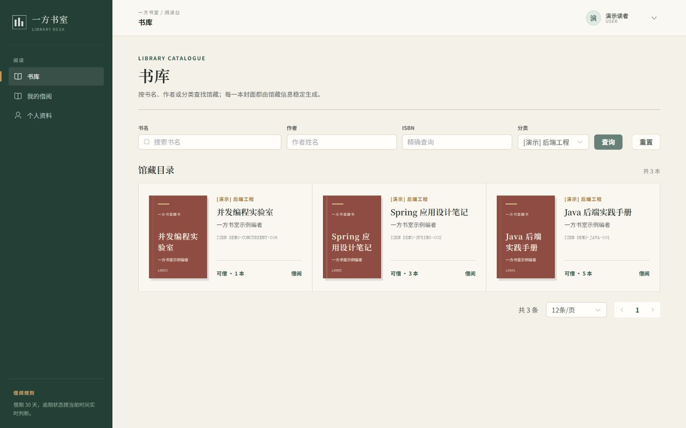
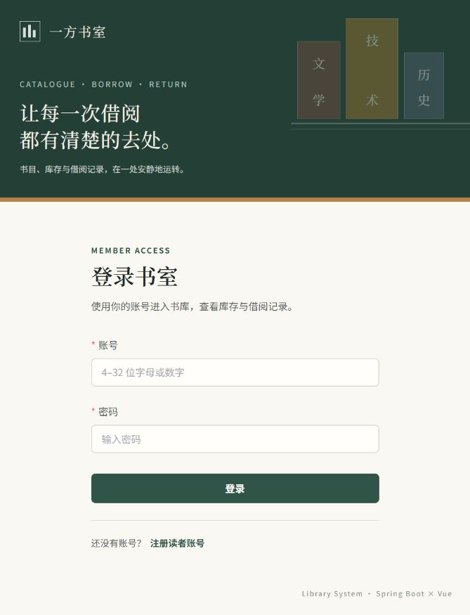
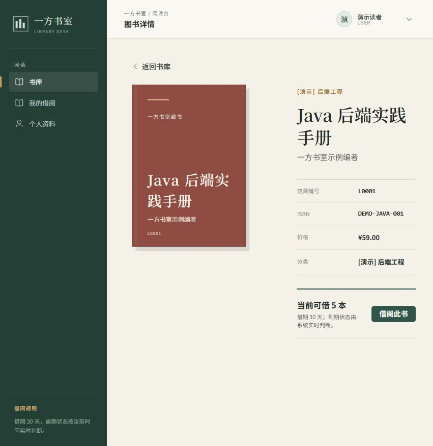
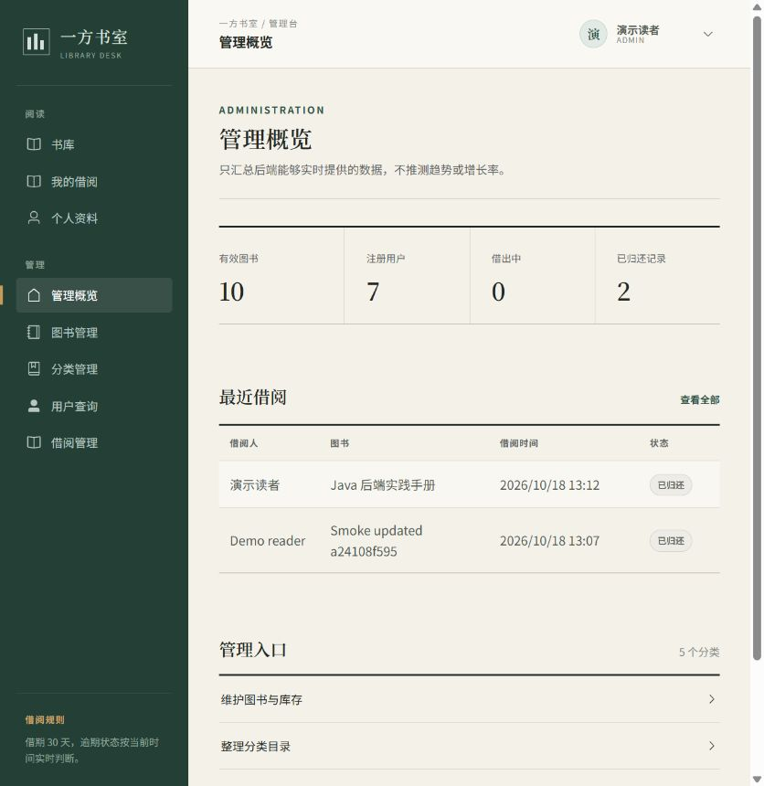
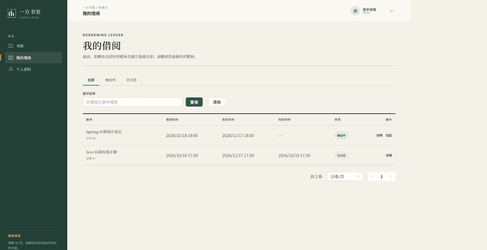

# 一方书室 · 图书管理系统

[](https://github.com/kun520c/library/actions/workflows/ci.yml)

基于 Spring Boot 3 与 Vue 3 实现的前后端分离图书管理系统，支持注册登录、图书与分类管理、借阅归还和记录查询。围绕借阅业务实践数据库事务、权限与数据所有权校验、并发库存更新及 Redis 缓存，保持单体分层结构。



<details>
<summary>查看更多真实界面：登录 / 图书详情 / 管理概览 / 借阅记录</summary>

| 登录 | 图书详情 |
| --- | --- |
|  |  |
| 管理概览 | 我的借阅 |
|  |  |

截图来自本地运行的 Vue + Spring Boot + MySQL + Redis；书目为虚构演示数据，书封由现有 CSS 组件生成。复现见 [演示手册](docs/DEMO.md)。

</details>

## 技术栈

| 技术 | 使用位置 | 主要作用 |
| --- | --- | --- |
| Java 21 / Spring Boot 3.5.16 | 后端 | REST API、校验、事务管理 |
| MyBatis 3.0.5 / MySQL 8.4 | Mapper / 数据库 | 参数绑定、条件更新、约束和索引 |
| Redis 7.4 | 图书详情 | Cache-Aside、空值缓存、故障回源 |
| JJWT / BCrypt | 身份与密码 | HS256 Token、密码哈希 |
| Vue 3 / TypeScript | `frontend/` | 用户与管理员页面 |
| Pinia / Vue Router / Axios / Element Plus | 前端 | 身份状态、路由、API 和交互组件 |
| JUnit / Mockito / H2 / GitHub Actions | 测试与 CI | 单元、Web、安全与事务回归 |

## 值得查看的实现

- **并发借书**：[条件 UPDATE](src/main/java/com/library/mapper/BookMapper.java) 仅在库存大于 0 时扣减；[借阅事务](src/main/java/com/library/service/impl/BorrowServiceImpl.java) 将扣库存与创建记录绑定，插入失败整体回滚。管理员使用 `delta` 调库存，避免旧表单覆盖并发变更。
- **防重复归还**：[状态条件更新](src/main/java/com/library/mapper/BorrowRecordMapper.java) 只有一个请求能从 `BORROWED` 改为 `RETURNED`，同一事务只恢复一次库存；重复请求返回 409。这是业务状态防重，没有实现通用幂等键。
- **详情缓存**：[Cache-Aside 与空值缓存](src/main/java/com/library/service/impl/BookServiceImpl.java)、[提交后失效](src/main/java/com/library/service/BookCacheInvalidator.java)，Redis 异常回源。并发旧值回填、删除失败等仍可能造成 TTL 窗口内的不一致，详见 [设计决策](docs/DESIGN_DECISIONS.md)。
- **认证与权限**：[JWT](src/main/java/com/library/security/JwtService.java) + [MVC 拦截器](src/main/java/com/library/interceptor/AuthenticationInterceptor.java) + USER/ADMIN 角色；[Service](src/main/java/com/library/service/impl/BorrowServiceImpl.java) 校验借阅所有权，ThreadLocal 在请求结束清理。注册固定创建 USER，密码使用 BCrypt。

## 快速开始（Windows PowerShell）

要求 JDK 21、Node.js 24 / npm 11、Git、已启动的 Docker Desktop（Linux containers）。Maven Wrapper 要求 Maven 3.9+，首次运行自动下载。

在仓库根目录执行；已有 `.env` 或私人配置时先核对连接目标，以下命令保留已有文件：

```powershell
if (!(Test-Path .env)) { Copy-Item .env.example .env }
if (!(Test-Path src/main/resources/application-local.yaml)) {
    Copy-Item src/main/resources/application-local.example.yaml src/main/resources/application-local.yaml
}
# 为新示例配置生成本地随机密钥；不会替换自己已经设置的值。
$envText = Get-Content .env -Raw
$localSecret = [guid]::NewGuid().ToString('N') + [guid]::NewGuid().ToString('N')
$envText.Replace('replace-with-at-least-32-byte-local-secret', $localSecret) |
    Set-Content .env -Encoding utf8
. ./scripts/Import-LocalEnv.ps1
docker compose config --quiet
docker compose up -d --wait
$OutputEncoding = [Text.UTF8Encoding]::new($false)
Get-Content -Raw -Encoding utf8 sql/seed-demo.sql |
    docker compose exec -T mysql sh -c 'MYSQL_PWD="$MYSQL_PASSWORD" exec mysql --default-character-set=utf8mb4 -u"$MYSQL_USER" "$MYSQL_DATABASE"'
.\mvnw.cmd spring-boot:run
```

Compose 在**全新数据卷**中自动把 [`sql/schema.sql`](sql/schema.sql) 导入 `MYSQL_DATABASE`；已有卷不会重新初始化，不要用删除卷的方式升级真实数据。若修改库名、用户名或端口，需要同步 `.env` 中的 `DB_URL`、`DB_USERNAME`、`DB_PASSWORD`。旧版私人 local 配置若含固定 CORS 列表，应移除该列表，让公共配置读取 `CORS_ALLOWED_ORIGINS`。

上述 seed 脚本可重复执行，不创建账号、不重置库存。另开 PowerShell，在仓库根目录启动前端：

```powershell
cd frontend
npm ci
npm run dev -- --strictPort
```

访问 <http://localhost:5173>，点击“注册读者账号”，自行设置演示账号和密码；登录后即可借还书。管理员由维护者在**本地数据库**授予角色并重新登录，具体步骤见 [DEMO](docs/DEMO.md)。后端为 <http://localhost:8080>，local API 文档为 <http://localhost:8080/doc.html>；Vite 将 `/api` 代理到 8080。

## 文档导航

| 文档 | 内容 |
| --- | --- |
| [架构](docs/ARCHITECTURE.md) | 组件、分层、表关系、JWT 与借还书流程 |
| [设计决策](docs/DESIGN_DECISIONS.md) | 方案选择、原因与代价 |
| [演示手册](docs/DEMO.md) | 从零启动、管理员、借还书、越权验证、截图 |
| [测试](docs/TESTING.md) | 测试边界、命令、真实环境验证记录 |
| [API](docs/API.md) | 接口权限与请求参数 |
| [配置与数据库](docs/CONFIGURATION.md) | 环境变量、非 Docker 启动、旧库迁移 |
| [质量审查](docs/REVIEW.md) | 分级问题、改进记录与已知边界 |
| [前端](frontend/README.md) | 页面、部署代理、客户端约定 |

## 构建与验证状态

```powershell
.\mvnw.cmd -B clean verify
cd frontend
npm ci
npm run type-check
npm run lint
npm run build
```

CI [工作流](.github/workflows/ci.yml) 在 main push 和 PR 中执行 Maven verify、前端类型检查、Lint 和构建。后端有 **110 项测试**；隔离 MySQL / Redis 的 36 项 HTTP Smoke 与浏览器操作由本地单独执行，不属于当前 CI。各次执行的版本、环境、结果和未覆盖项见 [TESTING](docs/TESTING.md)。H2 测试不能替代 MySQL 验证，徽章显示的是 main 的远程状态。

## 当前范围

这是教学与工程实践项目，尚无生产运行、性能或用户规模数据。权限只有 USER/ADMIN，没有复杂 RBAC、Token 撤销、Refresh Token、预约、续借、罚款、微服务或消息队列。缓存允许短暂不一致；浏览器 Smoke 检查是人工操作，尚无持续运行的前端自动化 E2E。前端构建仍有大 chunk 提示，开发工具链仍有待上游修复的依赖审计告警，详见测试记录。
