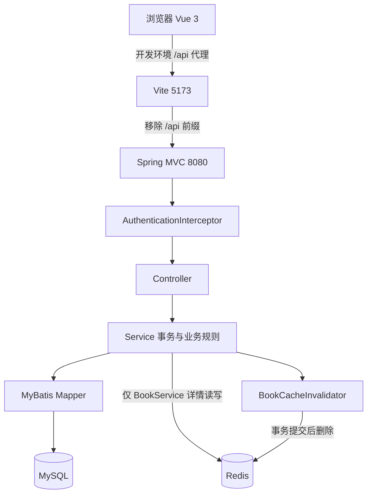
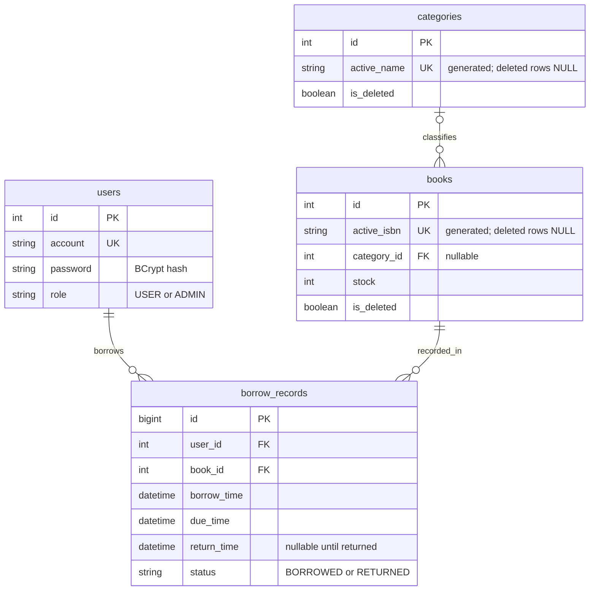
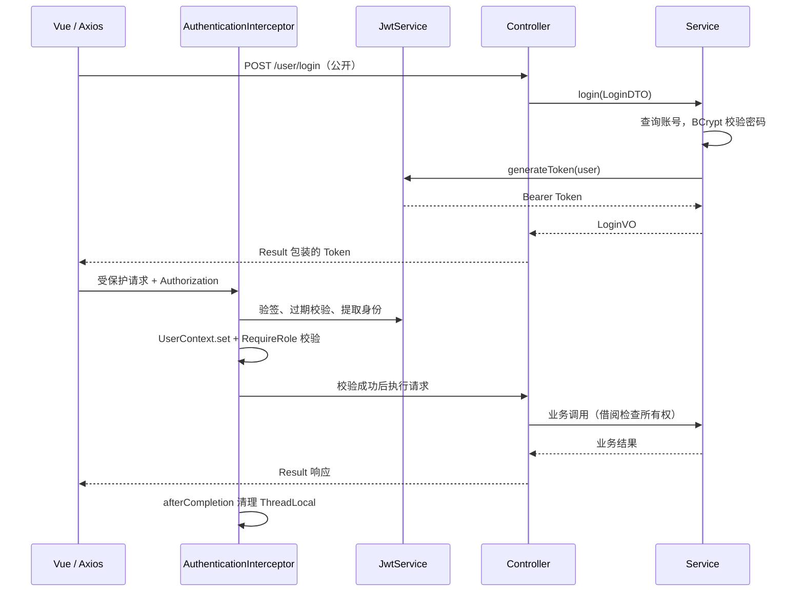
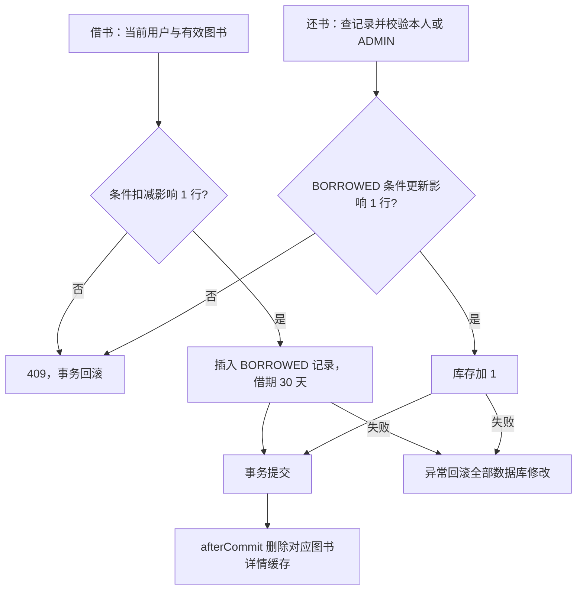

# 系统架构

## 组件与调用关系

生产构建输出静态文件，由部署者配置 Web Server 和 `/api` 反向代理；Compose 当前只提供 MySQL 和 Redis，没有封装应用部署。没有网关、独立认证服务或消息系统。

## 分层职责

| 位置 | 职责与实际边界 |
| --- | --- |
| `frontend/src/api`、`stores`、`router`、`views` | Axios 调用、身份恢复、页面守卫、真实接口数据展示；权限最终由后端执行 |
| [Controller](../src/main/java/com/library/controller) | HTTP 路由、DTO 校验、Result 包装、管理员注解 |
| [Service](../src/main/java/com/library/service/impl) | 事务、所有权、分类/ISBN/借阅约束；Book 管缓存，Borrow 管借还 |
| [Mapper](../src/main/java/com/library/mapper) / [XML](../src/main/resources/mapper) | 参数化 SQL、分页、条件更新、必要行锁 |
| [DTO / Entity / VO](../src/main/java/com/library/model) | 输入白名单 / 数据库映射 / 输出契约；管理员用户分页直接投影安全 VO |
| [security](../src/main/java/com/library/security)、[interceptor](../src/main/java/com/library/interceptor) | JWT 签发解析、当前用户上下文、角色注解 |
| [config](../src/main/java/com/library/config)、[exception](../src/main/java/com/library/exception) | 类型化配置、CORS、时钟、密码编码、异常 HTTP 状态与脱敏 |

## 表关系

完整 DDL 见 [schema.sql](../sql/schema.sql)。分类与图书逻辑删除，借阅保留历史关联。账号唯一；生成列保证活动 ISBN 和活动分类名称唯一。外键约束关联存在，CHECK 约束借期与归还状态/时间，索引覆盖活动图书、分类和用户/图书/状态借阅查询。`overdue` 由未归还状态与当前时间计算，不持久化。

## JWT 请求流程

未认证返回 401，已认证但角色/所有权不符返回 403。OPTIONS 放行，CORS 来源仍由 WebConfig 限制；登录、注册、错误页和开发文档不经过认证。prod 关闭文档映射。JWT 中的角色与用户名是签发快照，详见 [权限边界](DESIGN_DECISIONS.md#8-jwt-与角色权限)。

## 借还书事务

图书删除先锁定图书行，再检查未归还记录；分类维护先锁定分类行，阻止并发新增/修改图书引用已删除分类。管理员编辑基本信息不更新库存，库存接口使用受范围约束的 delta SQL。并发测试位置见 [TESTING](TESTING.md)。
